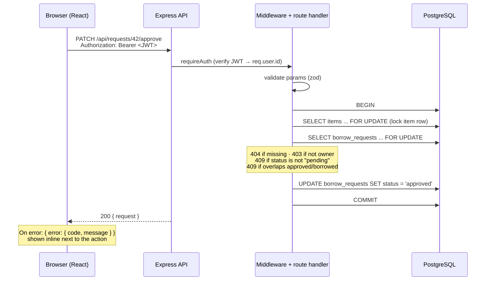
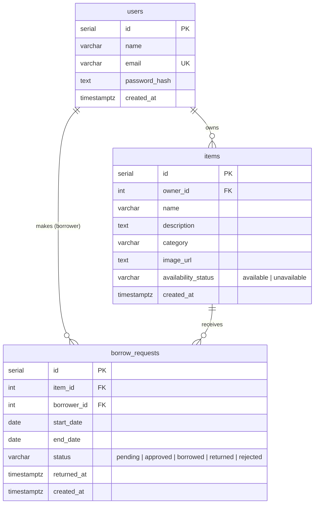

# BorrowBuddy — Architecture

## Stack

| Layer | Choice |
| --- | --- |
| Frontend | React 19 + Vite, React Router, `fetch`, plain CSS (light/dark via `prefers-color-scheme`) |
| Backend | Node.js + Express 5, `pg`, `bcrypt`, `jsonwebtoken`, `multer`, `cors`, `dotenv`, `zod` |
| Database | PostgreSQL 16 (local Docker container), plain SQL migration files |
| Auth | JWT bearer tokens (7-day expiry), stored in `localStorage` on the client |
| Deployment | Docker Compose: `postgres:16-alpine`, `node:22-alpine` API, Vite build served by `nginx:1.27-alpine` (proxies `/api`, `/uploads`) |
| Images | Uploaded with `multer` to `server/uploads/`, served statically at `/uploads/<file>`; path stored in `items.image_url` |

## Folder structure

```
borrowbuddy/
├── docker-compose.yml          # db + server + client(nginx) stack; db published on 5433 for local dev
├── .env.example                # Compose variables
├── README.md
├── docs/                       # SCOPE, ARCHITECTURE, API, DATABASE, TESTING
├── server/
│   ├── Dockerfile  .dockerignore  .env.example
│   ├── migrations/001_init.sql # schema
│   ├── seeds/seed.sql          # 4 demo users, 4 demo items
│   ├── scripts/
│   │   ├── dbTarget.js         # parses DATABASE_URL, refuses any db not named "borrowbuddy"
│   │   ├── create.js migrate.js seed.js reset.js seedIfEmpty.js
│   │   └── smoke.js            # end-to-end API test (npm run smoke)
│   ├── uploads/                # item photos (git-ignored)
│   └── src/
│       ├── index.js            # startup: SELECT 1 check, then listen
│       ├── app.js              # express app, routes, error handler
│       ├── config.js db.js paths.js constants.js
│       ├── middleware/         # auth (JWT), validate (zod), upload (multer), errorHandler
│       ├── routes/             # auth.js, items.js, requests.js
│       └── utils/              # httpError.js, dates.js
└── client/
    ├── Dockerfile  nginx.conf  .dockerignore  .env.example
    └── src/
        ├── main.jsx App.jsx api.js constants.js index.css
        ├── context/AuthContext.jsx
        ├── components/         # Navbar, ProtectedRoute, ItemCard, StatusBadge, AddItemForm,
        │                       # IncomingRequests, Feedback (Loading/ErrorMessage/EmptyState)
        ├── pages/              # Home, ItemDetail, Login, Register, MyItems, MyRequests
        └── utils/format.js     # date formatting helpers
```

## Request flow



How a request travels through the server:

1. **CORS** allows only `CLIENT_URL`. **express.json** parses JSON bodies, limited to 100 KB.
2. **requireAuth** checks the `Authorization: Bearer` token and sets `req.user = { id }`.
3. **uploadImage** (create/patch item only) parses multipart data, enforces jpg/png/webp up to 2 MB, and checks the file's magic bytes.
4. **validate(schema)** parses and normalizes input with zod. Failures return 400 `VALIDATION_ERROR`.
5. The **route handler** runs parameterized SQL only. Writes that depend on a check run inside `withTransaction` with the item row locked (`SELECT … FOR UPDATE`), so two concurrent approvals or requests cannot double-book.
6. The **errorHandler** turns every error into `{ error: { code, message } }` with the right status code.

On the client, `api.js` wraps `fetch`. It attaches the token, parses the error shape into an `ApiError`, and fires an `auth:expired` event on 401, which logs the user out.

## Authorization model

| Action | Who |
| --- | --- |
| Browse / view item | Anyone |
| Create item | Any logged-in user |
| Edit / delete item | Item owner (delete blocked while pending/approved/borrowed requests exist) |
| Create request | Any logged-in user except the item owner; item must be available; dates must not overlap approved/borrowed requests |
| View a request | Borrower or item owner |
| Approve / reject / mark borrowed / mark returned | Item owner only |

## ER diagram



See [DATABASE.md](DATABASE.md) for constraints, indexes and the status state machine.
