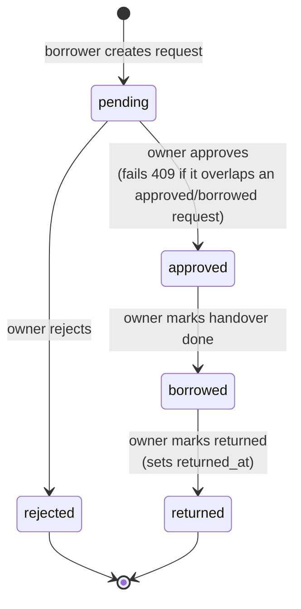

# BorrowBuddy — Database

- **Engine:** PostgreSQL 16
- **Database name:** `borrowbuddy` (dedicated; the migrate/reset scripts refuse to run against any other name)
- **Schema file:** [`server/migrations/001_init.sql`](../server/migrations/001_init.sql)
- **Seed file:** [`server/seeds/seed.sql`](../server/seeds/seed.sql)
- **Migration tracking:** `schema_migrations(filename, applied_at)`. Each `.sql` file in `server/migrations/` runs once, in filename order, inside a transaction.

## Tables

### `users`

| Column | Type | Notes |
| --- | --- | --- |
| `id` | `SERIAL` | Primary key |
| `name` | `VARCHAR(100)` | Required |
| `email` | `VARCHAR(255)` | Required, **unique**, stored lower-case |
| `password_hash` | `TEXT` | bcrypt hash (cost 10). Never returned by the API |
| `created_at` | `TIMESTAMPTZ` | Default `NOW()` |

### `items`

| Column | Type | Notes |
| --- | --- | --- |
| `id` | `SERIAL` | Primary key |
| `owner_id` | `INTEGER` | FK → `users.id`, `ON DELETE CASCADE` |
| `name` | `VARCHAR(120)` | Required |
| `description` | `TEXT` | Default `''` |
| `category` | `VARCHAR(50)` | Required. The API restricts it to: Tools, Sports, Study, Outdoor, Electronics, Kitchen, Books, Other |
| `image_url` | `TEXT` | Nullable. Relative path such as `/uploads/<hex>.png` |
| `availability_status` | `VARCHAR(20)` | Default `'available'`. `CHECK IN ('available','unavailable')` |
| `created_at` | `TIMESTAMPTZ` | Default `NOW()` |
| `latitude`, `longitude` | `DOUBLE PRECISION` | Nullable (migration `002`). Approximate: the API rounds to 2 decimals (~1 km). Near-me distance uses the haversine formula in plain SQL (no PostGIS) |

### `borrow_requests`

| Column | Type | Notes |
| --- | --- | --- |
| `id` | `SERIAL` | Primary key |
| `item_id` | `INTEGER` | FK → `items.id`, `ON DELETE CASCADE` (the API blocks deleting items with active requests, so only finished history is cascaded) |
| `borrower_id` | `INTEGER` | FK → `users.id`, `ON DELETE CASCADE` |
| `start_date` | `DATE` | Required |
| `end_date` | `DATE` | Required |
| `status` | `VARCHAR(20)` | Default `'pending'` |
| `returned_at` | `TIMESTAMPTZ` | Set when status becomes `returned` |
| `created_at` | `TIMESTAMPTZ` | Default `NOW()` |

### `needs` (migration `003`)

| Column | Type | Notes |
| --- | --- | --- |
| `id` | `SERIAL` | PK |
| `user_id` | `INTEGER` | FK → `users.id`, `ON DELETE CASCADE` (the poster) |
| `title` | `VARCHAR(120)` | Required |
| `description` | `TEXT` | Default `''` |
| `category` | `VARCHAR(50)` | Same fixed list as items (enforced by the API) |
| `needed_from`, `needed_until` | `DATE` | `needs_dates_check`: `needed_until >= needed_from` |
| `status` | `VARCHAR(20)` | `needs_status_check`: `open` or `closed`. Expiry is computed (`needed_until < today`), not stored |
| `created_at` | `TIMESTAMPTZ` | Default `NOW()` |

### `need_offers` (migration `003`)

| Column | Type | Notes |
| --- | --- | --- |
| `id` | `SERIAL` | PK |
| `need_id` | `INTEGER` | FK → `needs.id`, `ON DELETE CASCADE` |
| `item_id` | `INTEGER` | FK → `items.id`, `ON DELETE CASCADE`. The offerer is the item's owner |
| `created_at` | `TIMESTAMPTZ` | Default `NOW()` |

`need_offers_unique` (`need_id`, `item_id`) stops the same item being offered twice. Indexes: `needs(status, category)`, `needs(user_id)`, `need_offers(item_id)`.

## Constraints

| Name | Rule |
| --- | --- |
| `users.email` UNIQUE | One account per email |
| `items.availability_status` CHECK | `IN ('available','unavailable')` |
| `items_location_check` | `latitude`/`longitude` both set or both null, within ±90 / ±180 |
| `borrow_requests_dates_check` | `end_date >= start_date` |
| `borrow_requests_status_check` | `status IN ('pending','approved','borrowed','returned','rejected')` |

These rules are enforced in application code, not by DB constraints:

- The start date must be today or later (server local date). This can't be a CHECK constraint because "today" changes.
- No overlap between `approved`/`borrowed` requests on the same item. The API checks this inside a transaction that locks the item row (`SELECT … FROM items WHERE id = $1 FOR UPDATE`), both when a request is created and when one is approved.

## Indexes

| Index | Columns | Used by |
| --- | --- | --- |
| `idx_items_category` | `items(category)` | Category filter on browse |
| `idx_items_name` | `items(name)` | Name lookups/sorting. Note: `ILIKE '%term%'` search cannot use a B-tree index. A `pg_trgm` GIN index is the upgrade path if the table grows |
| `idx_borrow_requests_item_status` | `borrow_requests(item_id, status)` | Overlap checks, pending counts, delete guard |
| `idx_borrow_requests_borrower` | `borrow_requests(borrower_id)` | "My requests" |

## Status state machine

- Only the item's **owner** can move a request between states.
- Any other transition (for example `approved → rejected`, `pending → borrowed`, `returned → approved`) returns **409 `INVALID_TRANSITION`**.
- `approved` and `borrowed` **block** the item's calendar for `[start_date, end_date]` (inclusive). `pending`, `rejected` and `returned` do not.

## Seed data

All seed users share the password **`password123`**.

| User | Email | Item | Category |
| --- | --- | --- | --- |
| Asha Kumar | asha@example.com | Power Drill | Tools |
| Ben Carter | ben@example.com | Bicycle | Sports |
| Chen Li | chen@example.com | Calculator | Study |
| Divya Rao | divya@example.com | Camping Kit | Outdoor |

## Scripts

Run these from `server/`:

| Command | What it does |
| --- | --- |
| `npm run db:create` | Creates the `borrowbuddy` database if missing. It connects to the server's `postgres` maintenance DB only to issue `CREATE DATABASE` |
| `npm run db:migrate` | Applies pending migration files. Prints host and DB name; refuses unless the DB name is exactly `borrowbuddy` |
| `npm run db:seed` | Loads `seeds/seed.sql` (fails if the demo emails already exist; use reset) |
| `npm run db:reset` | Drops and recreates the `public` schema, then migrates and seeds. Same name guard, and it also double-checks `current_database()` |
